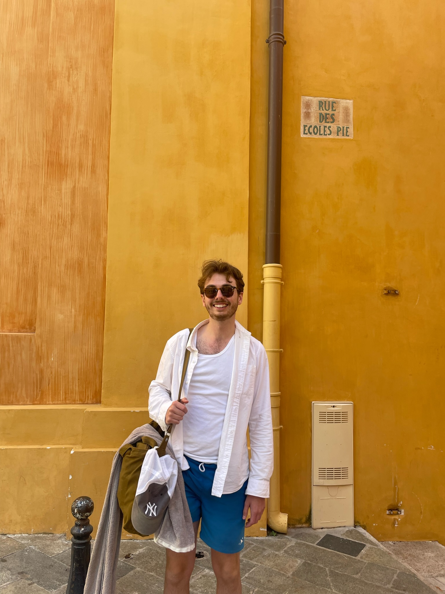

{.profile fig-alt="Benjamin Stubbing" width="160"}

A recovering Aucklander, making amends in Wellington where I work for the Treasury in the Analytics, Insights, and Modelling team. We provide research and analysis to make trade-offs legible to decision-makers.

> *Where is the wisdom we have lost in knowledge?*\
> *Where is the knowledge we have lost in information?*
>
> [— T.S. Eliot, *Choruses from "The Rock"*]{.attribution}

I'm enthusiastic about creating a future of abundance: building a materially healthy society that nourishes welfare, ameliorating places where bad rules impede the common good, and growing the things that make a nation great and the world a better place. That is, in Ezra Klein's words, the "stupidly simple" thesis that "to have the future we want, we need to build and invent more of the things that we need."

My chief vice has always been having too many interests; I love learning about anything and everything.[^boring] Take a look at my [Bookshelf](bookshelf.qmd) and [Writing](writing.qmd), e.g. [here are the coolest things I learned last year](https://cream-lift-9ad.notion.site/The-Coolest-Things-I-Learned-in-2025-in-no-particular-order-2ca06aff89f280a39ffddeada26cad7b?source=copy_link).

## More about me

- [Here's what I'm working on](https://cream-lift-9ad.notion.site/now-37806aff89f2808799bde2ce7b05105e?source=copy_link).
- Ko te rarawa, ko ngai takoto, ko Ngati-Awa-Nui-a-Rangi aku iwi. Kei Tamaki Makaurau taku kāinga.
- To let off steam, I regularly have it handed to me in [full-contact Origami](https://cream-lift-9ad.notion.site/Notes-on-BJJ-11206aff89f280ff8d40d154c3f1490a?pvs=4), I play tennis with mildly more success, and on occasion I dabble in violin and guitar after a fashion.
- On weekends, I circulate an old-school [links blast](https://benjaminstubbing.substack.com/) and I read [very slowly](https://docs.google.com/spreadsheets/d/1KL3Ung7reIdBaDlK3LkV5zmfuP8y-q6zHt0PIKVGFBw/edit?usp=sharing).
- Some of my favourite books are: *Dracula*, *Anna Karenina*, *Reasons and Persons*, and *The Man Who Was Thursday*.
- Here's a repository of [wisdom](writing/rules-for-life.qmd) I've amassed, infinitely wise being that I am.
- If you don't know me (or don't know me that well) and you get the impression that we'd get along, feel free to email me: benstubbing (at) gmail (dot) com.

[*N.B.*, the web design is a bootleg imitation of [Patrick Collison](https://patrickcollison.com/).]{.muted}

[^boring]: *Somehow the guy who's really interested in absolutely everything is really boring.* — James Richardson
